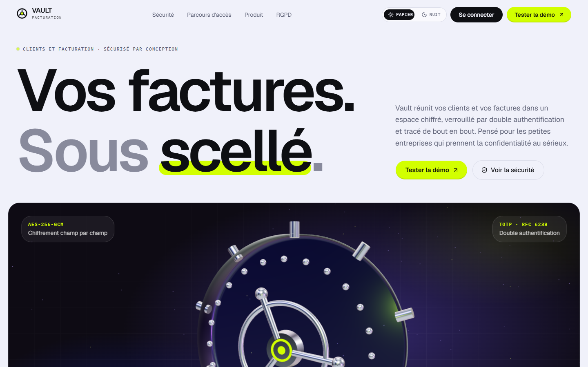
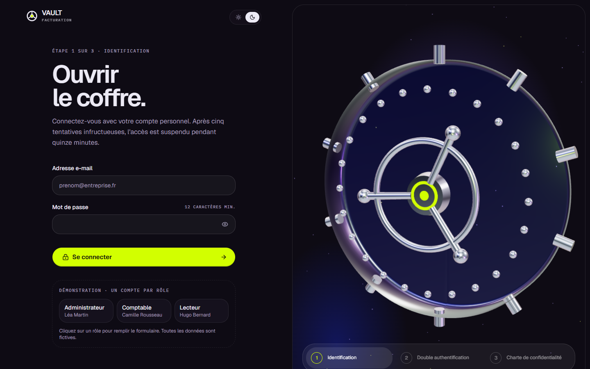
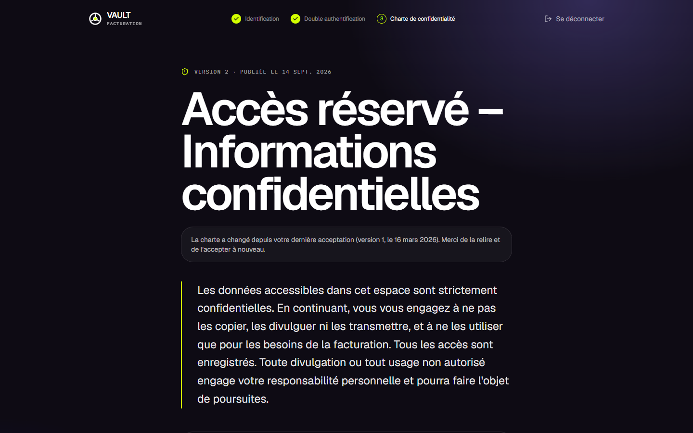
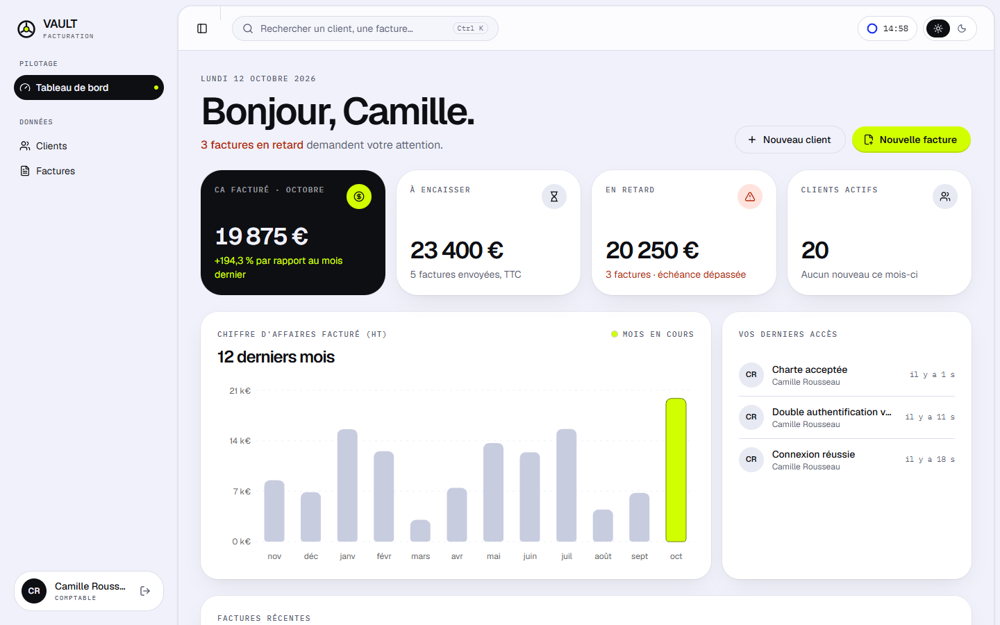
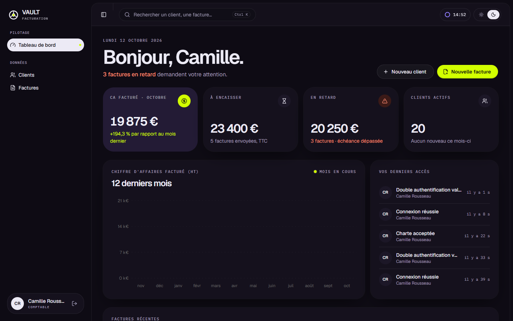
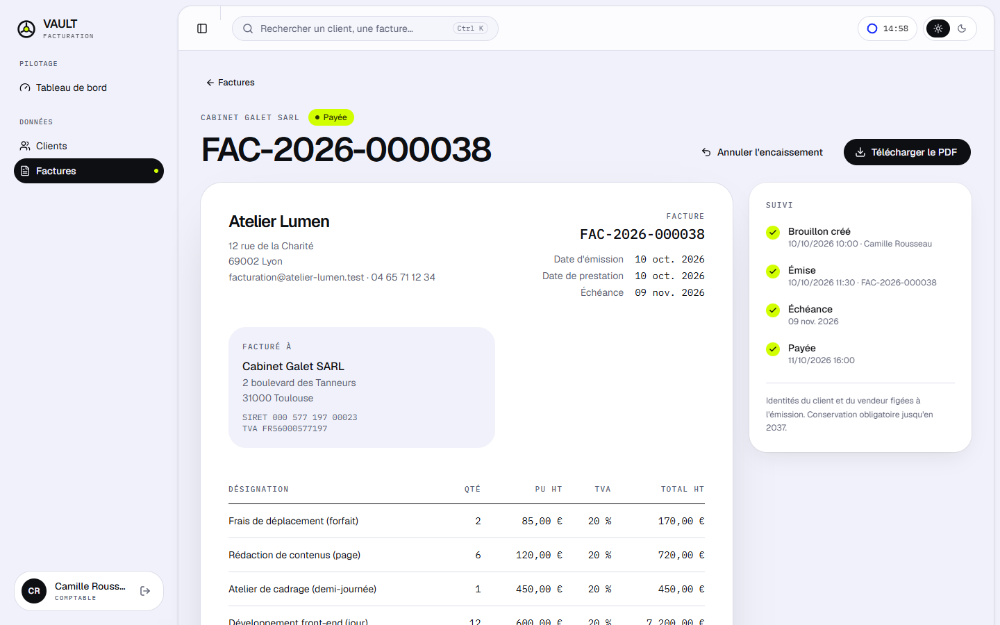
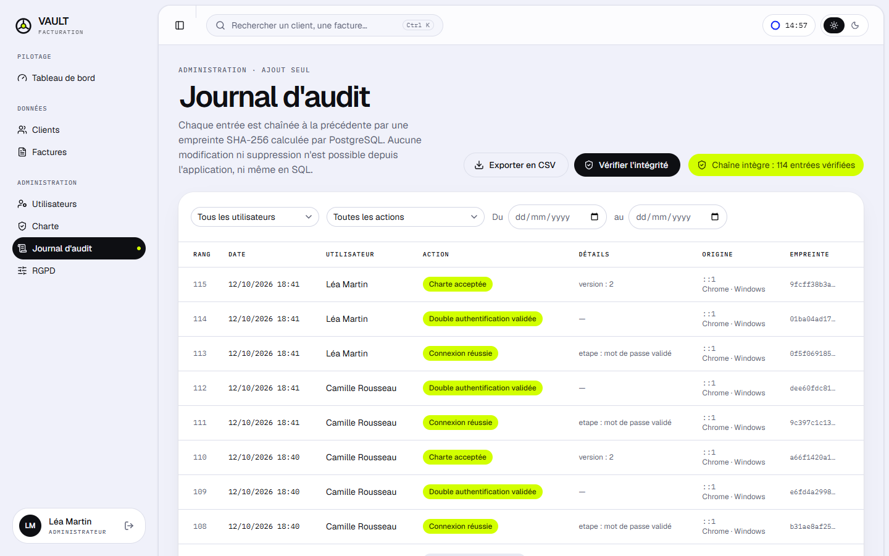
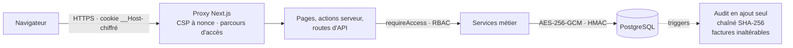

<div align="center">

# Vault Facturation

**Gestion des clients et de la facturation, sécurisée par conception.**
Chiffrement des données sensibles, double authentification obligatoire, charte de confidentialité,
journal d'audit inaltérable et conformité RGPD.

[Démo en ligne](https://vault-facturation.vercel.app) · [Sécurité](SECURITY.md) · [Comptes de démo](#comptes-de-démonstration)


</div>



> Projet de portfolio. L'entreprise « Atelier Lumen », ses clients et ses factures sont **entièrement fictifs**
> (SIREN en 000…, téléphones des plages de fiction de l'ARCEP, adresses en `.test`).

## Ce que fait l'application

| | |
|---|---|
| **Authentification forte** | Comptes personnels, Argon2id, 2FA TOTP obligatoire (QR code, codes de secours), verrouillage après 5 échecs, déconnexion après 15 min d'inactivité |
| **Charte de confidentialité** | Plein écran, case obligatoire, acceptation tracée (date, IP, navigateur, version), réacceptation à chaque nouvelle version, **blocage côté serveur** |
| **Rôles** | Administrateur, comptable, lecteur ; permissions vérifiées sur chaque page, action et route d'API |
| **Clients** | Recherche, filtres, pagination ; email, téléphone et adresse **chiffrés en AES-256-GCM** ; recherche par email via index aveugle |
| **Facturation** | Lignes et TVA par taux calculées au centime, **numérotation continue sans trou**, statuts (brouillon, envoyée, payée, en retard), facture émise inaltérable |
| **PDF** | Mentions légales françaises, filigrane « Confidentiel » avec le nom de l'exportateur et la date |
| **Journal d'audit** | Ajout seul imposé par PostgreSQL, chaîné en SHA-256, filtres, export CSV, vérification d'intégrité |
| **RGPD** | Durée de conservation réglable, purge automatique, export des données d'un client, anonymisation (factures conservées 10 ans), registre des traitements |

<table>
  <tr>
    <td></td>
    <td></td>
  </tr>
  <tr>
    <td></td>
    <td></td>
  </tr>
  <tr>
    <td></td>
    <td></td>
  </tr>
</table>

## Comptes de démonstration

Sur la [démo en ligne](https://vault-facturation.vercel.app/connexion), un clic sur un rôle remplit le formulaire.
En mode démonstration, l'écran de double authentification affiche le code TOTP courant **des seuls comptes de démo**,
pour tester le parcours complet sans téléphone. Les données sont réinitialisées chaque nuit.

| Rôle | Email | Mot de passe | Peut |
|---|---|---|---|
| Administrateur | `admin@vault-demo.test` | `Vault-Demo-2026!` | Utilisateurs, charte, journal d'audit, RGPD, export PDF |
| Comptable | `comptable@vault-demo.test` | `Vault-Demo-2026!` | Créer et modifier clients et factures, émettre, exporter |
| Lecteur | `lecteur@vault-demo.test` | `Vault-Demo-2026!` | Consulter uniquement, sans export |

## Démarrer

### Avec Docker (une commande)

```bash
docker compose up
```

L'application est sur http://localhost:3000. Au premier lancement, `docker compose` génère les secrets dans un volume
(aucun secret n'est versionné), applique les migrations et charge les données de démonstration.

### Sans Docker

Node.js 24 suffit : `npm run db:dev` lance un vrai PostgreSQL local (binaires fournis par npm).

```bash
npm install
npm run setup:env      # crée .env avec des clés aléatoires
npm run db:dev         # PostgreSQL sur le port 5433 (laisser tourner)
npx prisma migrate deploy
npm run db:seed
npm run dev
```

Pour activer l'aide à la connexion des comptes de démo en local, ajoutez `DEMO_MODE="true"` dans `.env`.

### Scripts

| Commande | Rôle |
|---|---|
| `npm run dev` / `build` / `start` | Développement, build, production |
| `npm run lint` · `npm run typecheck` | ESLint, TypeScript strict |
| `npm test` | Tests unitaires (Vitest) |
| `npm run test:integration` | Tests sur une vraie base PostgreSQL |
| `npm run test:e2e` | Tests de bout en bout (Playwright) |
| `npm run db:seed` | Recharge les données de démonstration (le journal d'audit est conservé) |

## Architecture



```
src/
├─ proxy.ts                 CSP par requête, blocage des données tant qu'une étape d'accès manque
├─ auth.ts                  Auth.js : cookie chiffré contenant un identifiant de session opaque
├─ app/
│  ├─ (public)/             accueil, confidentialité, registre des traitements, mentions légales
│  ├─ (auth)/               connexion, 2FA, activation, mot de passe, charte (+ actions serveur)
│  ├─ (app)/app/            tableau de bord, clients, factures, compte, administration
│  └─ api/                  PDF, export CSV et RGPD, tâches planifiées, santé
├─ server/                  accès aux données (jamais importé côté client)
│  ├─ auth/                 sessions, parcours d'accès, gardes, Argon2id, TOTP
│  ├─ crypto.ts             AES-256-GCM, HKDF, index aveugle
│  ├─ audit.ts              journalisation et vérification de la chaîne
│  ├─ invoices/  clients/   règles métier (émission, numérotation, anonymisation)
│  └─ pdf/                  facture PDF filigranée
├─ lib/                     calculs en entiers, validation Zod, permissions (testés)
└─ components/              interface (shadcn/ui, Tailwind v4, scène 3D WebGL)
prisma/
├─ schema.prisma
└─ migrations/              dont les triggers d'intégrité en SQL
```

**Stack** : Next.js 16 (App Router), TypeScript strict, Tailwind CSS v4, shadcn/ui, PostgreSQL, Prisma 7,
Auth.js, Zod, Vitest, Playwright, Docker, GitHub Actions. Interface : Geist et IBM Plex Mono, motion, Lenis,
React Three Fiber.

## Choix techniques

- **La base protège ce qui compte.** Ajout seul du journal, inaltérabilité des factures émises et cohérence des montants sont imposés par des triggers et contraintes PostgreSQL : un bug applicatif ou un accès SQL direct ne peut pas les contourner.
- **Calculs en entiers.** Centimes, millièmes de quantité et points de base de TVA : aucun arrondi flottant. La TVA est calculée par taux sur la base cumulée, comme le récapitulatif imposé sur la facture.
- **Numéro attribué à l'émission.** Un brouillon n'a pas de numéro : le supprimer ne crée aucun trou. L'incrément se fait dans la transaction d'émission.
- **« En retard » est calculé**, jamais stocké : il ne peut pas être désynchronisé de l'échéance.
- **Identités figées.** À l'émission, la facture copie (chiffrée) l'identité du client et du vendeur : elle reste exacte même après modification ou anonymisation de la fiche.
- **Pas de Cache Components.** La CSP par nonce impose un rendu dynamique, et aucune donnée confidentielle ne doit atterrir dans un cache partagé.
- **Sessions en base derrière Auth.js.** Le cookie ne transporte qu'un identifiant : révocation immédiate, inactivité contrôlée côté serveur, état 2FA et charte vérifiés à chaque requête.

Le détail des mesures, des compromis et de ce qu'il reste à faire avant une vraie mise en production est dans **[SECURITY.md](SECURITY.md)**.

## Tests

- **Unitaires** (47) : calculs de facture et arrondis, saisie française, chiffrement (altération, contexte, rotation), index aveugle, validation (SIRET, téléphone, mot de passe), matrice des permissions, CSP, configuration.
- **Intégration** (9, vraie base) : 20 émissions simultanées sans trou ni doublon, numéro non consommé en cas d'échec, factures inaltérables même en SQL, journal en ajout seul et détection d'une falsification.
- **Bout en bout** (9) : identifiants invalides, accès sans session, 2FA imposée, blocage serveur avant la charte, permissions par rôle, parcours complet client → facture → émission → PDF → encaissement, en-têtes de sécurité.

La CI GitHub Actions lance lint, typecheck, tests unitaires, tests d'intégration et de bout en bout sur PostgreSQL,
puis vérifie `docker compose up`.

## Auteur

Ebubekir Arti · projet de portfolio · 2026
